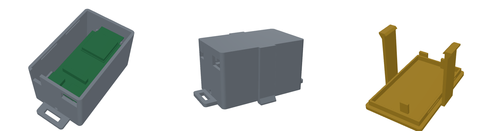

# Case for the ESP32-C6-DevKitC-1

A two-part case for the reference board, sized for an outdoor meter cabinet.



| File | What it is |
| --- | --- |
| `base.stl` | The tray the board sits in. Print it standing on its back |
| `lid.stl` | Clip-on lid. Already turned plate-down for printing |
| `assembled-preview.stl` | Both parts together, for viewing only. Do not print |
| `case.py` | Generates the STL files. Every size is a parameter at the top |

Outside size is 39 × 63 × 38 mm, plus a strap ear at each end (81 mm long overall).

## Before you print, check two things

The case assumes the board came with its header pins soldered pointing down,
and that you connected to them with ordinary Dupont jumper plugs. That needs
24 mm of room under the board. If you soldered wires straight to the pins,
or used right-angle plugs, you can make the case shallower: change `BELOW` in
`case.py` and run it again.

The cable opening is 7 × 4.5 mm, which suits a flat six-wire RJ12 cable or a
round cable up to about 4.5 mm. Change `CABLE` if yours is bigger.

## Printing

- **Material: PETG, not PLA.** A meter cabinet in the sun gets hot enough to
  soften PLA, and PETG copes better with damp.
- 0.2 mm layers, 4 walls, 20 to 30% infill.
- No supports needed. The base prints on its back with the open side up. The
  lid prints plate-down, with its two clip arms standing up; a brim helps the
  arms stay put on the bed.

## Fitting

1. Sit the board in the base with the antenna end at the far end from the
   openings. It drops onto two supports and is held by guides; nothing needs
   forcing. The port labelled "USB" lines up with the square opening.
2. Lay the RJ12 cable in the slot in the end wall. Put a cable tie tightly
   round the cable just inside the case, so a tug on the cable pulls on the
   case, not on the wires.
3. Press the lid on. A springy arm on each long side slides down the outside
   of the case and clicks under the back edge, and the lid's tab closes the
   cable slot. Two posts on the lid stop the board lifting. To open it, pull
   the small tab at the bottom of each arm outward and lift the lid.
4. Mount it with the openings facing **down**, so water cannot run in. The
   drain hole beside them lets out any condensation.

## Mounting in the meter cabinet

ESB Networks does not allow tools near the meter and requires anything you
fit to be removable. So:

- Do not screw or drill anything in the meter box, and do not fix the case to
  the meter itself.
- Use the slots in the two ears for a hook-and-loop strap or cable ties round
  something already in the cabinet, or stick hook-and-loop pads to the back of
  the case.
- The clip hooks stand about 1.6 mm proud of the back. Hook-and-loop pads are
  thicker than that, so the case still sits flat; if you strap it straight
  against a surface, put the pads near the ends, clear of the hooks.
- Keep the antenna end clear of metal for the best Wi-Fi signal.

See the [disclaimer](../../DISCLAIMER.md) for the full conditions.

## Changing the design

Install the two libraries and run the script:

```bash
pip install manifold3d trimesh numpy
```

```bash
python case.py
```

Board dimensions come from Espressif's drawing
`esp32-c6-devkitc-1-dimensions_v1.2` (25.4 × 51.8 mm board, antenna
overhanging the top edge by 6.35 mm). The case was checked against a 3D model
of the board, header pins, Dupont plugs and a USB-C plug for collisions, and
the base has been printed and test-fitted. The clip lid replaced an earlier
lid whose snap bumps did not hold; it works with a base printed before the
change.
